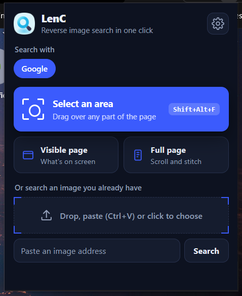
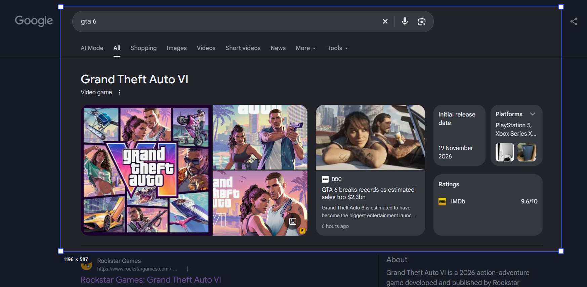
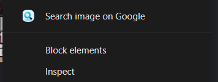
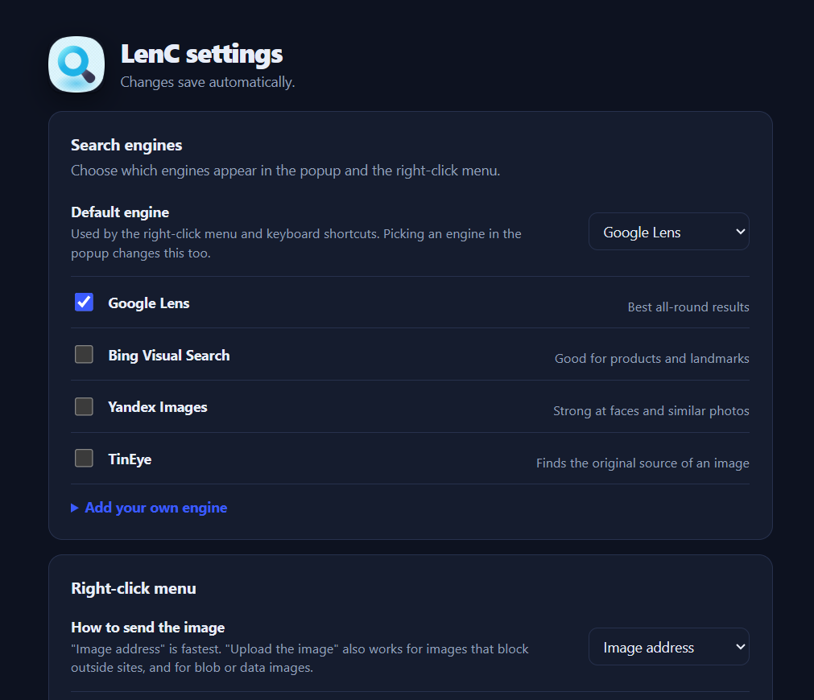
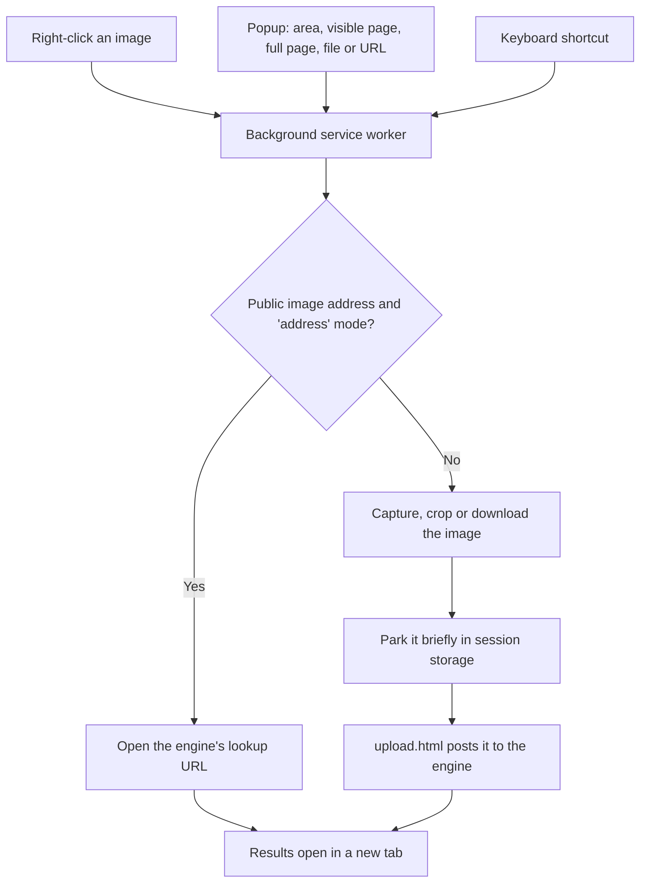

<div align="center">


# LenC

### Reverse image search, one click away.

Right-click an image, drag over any part of a page, or capture the whole screen.<br>
LenC sends it straight to Google Lens, Bing, Yandex or TinEye. No saving, no uploading, no tab juggling.

<br>


[Install](#-install) · [Features](#-features) · [How it works](#-how-it-works) · [Settings](#-settings) · [FAQ](#-faq)

</div>

---

## 📸 Preview

<div align="center">

| Popup | Area selector | 
| :---: | :---: |
|  |  

| Context Menu | Settings |
| :---: | :---: |
|  |  |
</div>

---

## 🧩 The Problem

Finding where an image came from should take a second. In practice it takes five steps:

1. Spot an image you want to check.
2. Save it, or copy it.
3. Open Google Lens, Bing or another engine in a new tab.
4. Upload the file and wait.
5. Repeat it all on a second engine when the first one has nothing.

And it gets worse when the thing you want to search isn't a neat image file at all: a section of a web page, a product inside a screenshot, a photo in a feed that blocks right-click saving.

## 💡 The Thinking

I started from one question: **what is the shortest path from "I wonder where this is from" to the results page?**

- **Meet people where the image is.** The right-click menu and a keyboard shortcut beat a trip to another website every time.
- **Not everything is an ``.** A product in a collage or a detail in a screenshot needs a drag-to-select tool, so area and full-page capture became first-class features.
- **Fast first, robust second.** When an image has a public address, LenC hands that address to the engine instantly. When it doesn't (blocked, `blob:` or `data:` images, screenshots), it uploads the pixels instead.
- **Your engine, your choice.** Different engines are good at different things, so the engine list, the default and even custom engines are all settings, not hard-coded decisions.
- **Private by construction.** No server, no analytics, no accounts. An image leaves your browser only when you start a search, and it goes only to the engine you picked.
- **Zero build step.** Plain JavaScript modules and no dependencies, so anyone can read, fork and change it in minutes.

## ✅ The Solution

**LenC** is a Manifest V3 Chrome extension that puts reverse image search wherever you already are.

```text
Right-click an image  →  Search image on Google
Drag over a page area →  Results open in a new tab
Press Alt+Shift+F     →  Whole page, stitched and searched
```

---

## ✨ Features

### Search from anywhere

| | Feature | What it does |
| :-: | --- | --- |
| 🖱️ | **Right-click an image** | Adds "Search image on *your engine*". The name follows the engine you chose. |
| 🗂️ | **Engine submenu** | "Search image on…" lists every enabled engine, plus *All enabled engines* to open them side by side. |
| ✂️ | **Select an area** | Drag a box over any part of a page. Only that crop is searched. |
| 🖥️ | **Visible page** | Searches exactly what is on screen. |
| 📜 | **Full page** | Scrolls, captures and stitches the entire page. Sticky headers are hidden after the first screen so they don't repeat. |
| 📎 | **Bring your own image** | Drop a file, paste with `Ctrl+V`, choose a file, or paste an image address in the popup. |
| ⌨️ | **Keyboard shortcuts** | One keystroke for each capture mode (see below). |

### Search engines

| Engine | Good for | Image address | Upload |
| --- | --- | :-: | :-: |
| **Google Lens** | Best all-round results | ✅ | ✅ |
| **Bing Visual Search** | Products and landmarks | ✅ | ✅ |
| **Yandex Images** | Similar photos and faces | ✅ | ✅ |
| **TinEye** | Finding the original source | ✅ | ✅ |
| **Custom engine** | Anything that takes an image address in its URL | ✅ | ❌ |

> **Why no DuckDuckGo?** DuckDuckGo has no reverse image search, so there is nothing to send an image to. If you find a site that accepts an image address in its URL, add it as a custom engine.

### Shortcuts

| Action | Shortcut |
| --- | --- |
| Select an area | `Alt` + `Shift` + `A` |
| Search the visible page | `Alt` + `Shift` + `V` |
| Search the full page | `Alt` + `Shift` + `F` |

Change them any time at `chrome://extensions/shortcuts`.

---

## 🚀 Install

LenC isn't on the Chrome Web Store, so you load it directly from this folder. It takes about a minute.

### Option 1: Download the ZIP (easiest)

1. Click the green **Code** button at the top of this repository, then **Download ZIP**. (Or grab a ZIP from the **Releases** page.)
2. **Unzip** it to a folder you won't delete, because Chrome loads the extension from that location.
3. Open `chrome://extensions` in your browser.
4. Turn on **Developer mode** (top-right corner).
5. Click **Load unpacked** and select the unzipped folder, the one that contains `manifest.json`.
6. Click the puzzle-piece icon in the toolbar and **pin LenC** so it is always one click away.

### Option 2: Clone with Git

```bash
git clone https://github.com/<your-username>/LenC.git
```

Then follow steps 3 to 6 above and select the cloned `LenC` folder.

### Updating

Download or `git pull` the latest version over the same folder, then press the **reload** button on LenC's card in `chrome://extensions`.

### Other browsers

LenC uses standard Chromium extension APIs, so the same steps work in Edge (`edge://extensions`), Brave (`brave://extensions`) and Opera. Chrome 116 or newer is required.

<details>
<summary><b>🛠️ Troubleshooting</b></summary>

<br>

| Problem | Fix |
| --- | --- |
| "Manifest file is missing or unreadable" | You selected the wrong folder. Pick the one that directly contains `manifest.json`. |
| Right-click menu item is missing | Reload the extension, then reload the page you are on. |
| "Chrome doesn't let extensions capture this kind of page" | Chrome blocks extensions on `chrome://` pages and the Web Store. Try a regular website. |
| Area or full-page search opens a page with no results | The engine may have changed its upload address. See [Updating an engine](#-updating-an-engine). |
| Full page only captures part of a page | Sites that scroll inside a panel (rather than the whole page) can only be captured as far as the visible panel. Use *Select an area* instead. |
| A right-clicked image fails to search | Switch **How to send the image** to *Upload the image* in settings. |

</details>

---

## ⚙️ How it works



A few details worth knowing:

- **Area selection.** A tiny content script draws the drag-to-select overlay. After the overlay disappears, the background worker captures the tab and crops the selection, correcting for zoom and screen density.
- **Full page.** The worker scrolls the page one screen at a time, respecting Chrome's capture rate limit, then stitches the frames onto one canvas.
- **Uploads without a server.** An extension page builds a real `multipart/form-data` form and submits it to the engine, exactly as the engine's own "upload image" button would.
- **Short-lived storage.** Images are held in `chrome.storage.session` only long enough to hand over, and stale ones are cleared automatically. Session storage is also wiped when the browser closes.

### Project structure

```text
LenC/
├── manifest.json          # Extension definition (Manifest V3)
├── background.js          # Menus, shortcuts, capture, opening results
├── content/
│   └── selector.js        # Drag-to-select overlay
├── engines.js             # Every search engine's address and upload format
├── settings.js            # Defaults and storage helpers
├── popup.html / .css / .js
├── options.html / .css / .js
├── upload.html / .js      # Hands a screenshot to the engine's upload form
├── theme.css / theme.js   # Light, dark and accent colour
└── icons/                 # Extension icons
```

---

## 🎛️ Settings

Open the settings page by clicking the gear icon in the popup. Changes save automatically.

| Section | What you can change |
| --- | --- |
| **Search engines** | Which engines appear, the default engine, and your own custom engine |
| **Right-click menu** | Send by image address or upload, the engine submenu, the "Select area" item |
| **Results** | Open in the background, open next to the current tab |
| **Screenshots** | JPEG or PNG, quality, largest side, full-page height limit |
| **Appearance** | System, light or dark theme and an accent colour |
| **Shortcuts** | Shows your current keys and links to Chrome's shortcut page |

### Updating an engine

Search engines change their addresses from time to time. Everything engine-specific lives in one file, [`engines.js`](engines.js). Edit the address there, then reload the extension.

---

## 🔒 Privacy and permissions

LenC has **no servers, no analytics and no accounts**. Nothing is collected. An image is sent only when you start a search, and only to the engine you chose.

| Permission | Why it's needed |
| --- | --- |
| `contextMenus` | The right-click items |
| `storage` | Your settings, and a short-lived copy of an image while it is handed to the result tab |
| `scripting`, `activeTab` | Show the area selector and scroll the page for full-page capture |
| Access to all sites | Download a right-clicked image for upload, and capture the pages you choose |

---

## ❓ FAQ

<details>
<summary><b>Does LenC work offline?</b></summary>
<br>
The extension itself does, but the search engines don't, so you need a connection to see results.
</details>

<details>
<summary><b>Is my browsing history or any image stored?</b></summary>
<br>
No history is kept. An image is held in temporary session storage only while it is handed to the result tab, then cleared.
</details>

<details>
<summary><b>Why does it ask for access to all sites?</b></summary>
<br>
To capture the page you're on and to download an image you right-click. Nothing is read in the background.
</details>

<details>
<summary><b>Can I search more than one engine at once?</b></summary>
<br>
Yes. Choose <b>All</b> in the popup, or <b>All enabled engines</b> in the right-click submenu.
</details>

---

## 🗺️ Ideas for what's next

- [ ] Publish on the Chrome Web Store
- [ ] Firefox version
- [ ] Recent searches
- [ ] Copy text from a selected area (OCR)
- [ ] More built-in engines

Have an idea? [Open an issue](../../issues).

---

## 🤝 Contributing

Contributions are welcome, and because there is no build step it is easy to get started.

1. Fork the repository.
2. Create a branch: `git checkout -b my-improvement`
3. Make your change and reload the extension from `chrome://extensions` to try it.
4. Commit and open a pull request describing what changed and why.

---

<div align="center">

**If LenC saves you time, give it a ⭐. It helps others find it.**

Built by [Ankit Savaliya](https://github.com/Ankit5125) · [LinkedIn](https://www.linkedin.com/in/savaliya-ankit/)

</div>
